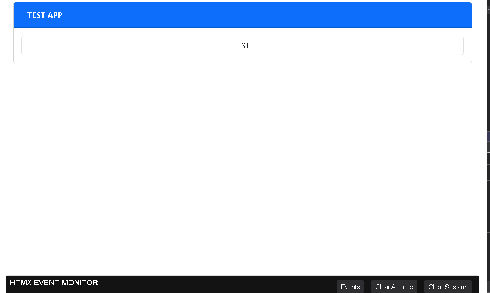
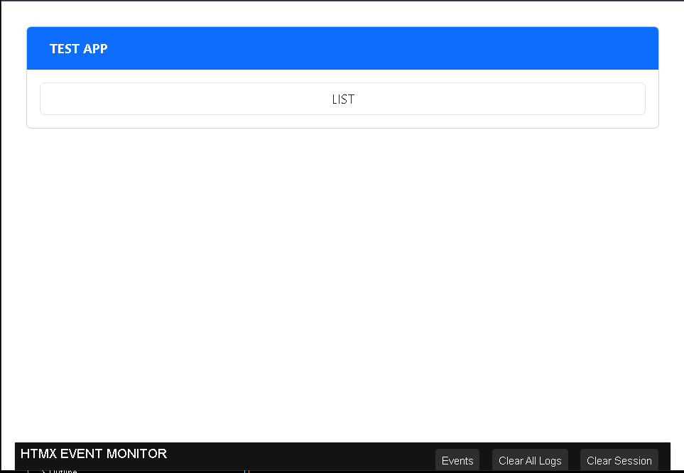
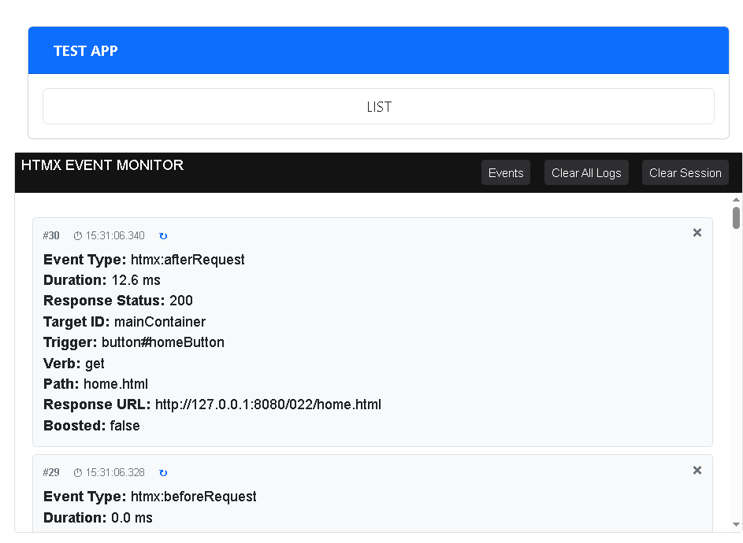
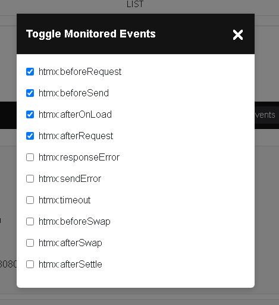
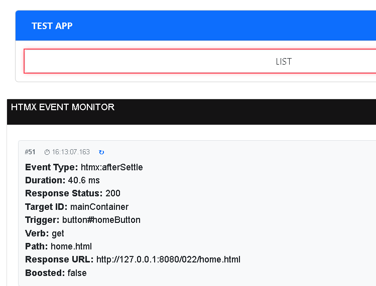

# HTMX Event Monitor

A lightweight, zero-dependency, vanilla JavaScript debugging widget designed specifically for HTMX applications. 

HTMX Event Monitor provides a non-intrusive bottom dock that logs lifecycle events in real time, tracks request durations, allows you to re-issue requests on the fly, and helps you visually inspect elements directly from the console.

<p align="center">
  
</p>

---

## ✨ Features

* **Zero Dependencies:** Pure vanilla JavaScript—easy to drop into any project without framework bloat.
* **Precise Duration Tracking:** Automatically measures how long individual HTMX requests take using high-resolution performance timers (handling concurrent requests seamlessly).
* **Request Re-running (`↻`):** Instantly re-issue any logged HTMX request using saved context parameters (`htmx.ajax()`).
* **Live DOM Highlighting:** Hovering over target IDs or triggers in the log inspects and highlights the corresponding elements on your live page.
* **Non-Intrusive UI:** Clean, collapsible bottom dock interface with a dedicated settings modal.
* **State Persistence:** Remembers your enabled/disabled event filters across page reloads using `sessionStorage`.
* **Customizable Defaults:** Easily override tracked events and log limits on initialization.

---

## 📸 Screenshots

| Collapsed Panel | Open Panel & Log Details |
| :---: | :---: |
|  |  |
| *Stays out of your way at the bottom of the screen.* | *Detailed inspection with request timing, verbs, paths, and action buttons.* |

| Event Picker Modal | Highlight Target Example |
| :---: | :---: |
|  |  |
| *Toggle exact HTMX lifecycle events on or off.* | *Configure max logs and default event states on startup.* |

---

## 🚀 Getting Started

### 1. Include the Script
Add `htmxeventmonitor.js` to your project:
```html
<script src="path/to/htmxeventmonitor.js"></script>
```
### 2. Initialize the Monitor
Initialize the monitor when the DOM loads, optionally passing custom configuration settings:

```HTML
<script>
    var parameters = {
        maxCount: 150, // Max log history to retain
        events: [
            { eventName: 'htmx:beforeRequest', eventEnabled: true },
            { eventName: 'htmx:beforeSend', eventEnabled: true },
            { eventName: 'htmx:afterOnLoad', eventEnabled: true },
            { eventName: 'htmx:afterRequest', eventEnabled: true },
            { eventName: 'htmx:responseError', eventEnabled: false },
            { eventName: 'htmx:sendError', eventEnabled: false },
            { eventName: 'htmx:timeout', eventEnabled: false },
            { eventName: 'htmx:beforeSwap', eventEnabled: false },
            { eventName: 'htmx:afterSwap', eventEnabled: false },
            { eventName: 'htmx:afterSettle', eventEnabled: false }
        ]
    };

    document.addEventListener("DOMContentLoaded", function () {
        initHTMXEventMonitor(parameters);
    });
</script>
```
🛠️ Usage Tips
Click the Header: Click anywhere on the HTMX EVENT MONITOR bottom bar to expand or collapse the log window.

Rerun Requests: Click the reload icon (↻) in any log header to instantly re-execute that exact HTMX request.

Inspect Elements: Hover your mouse over the Target ID or Trigger fields inside a log card to flash-highlight the active element on your web page.

Configure Events: Click the Events button in the top right of the widget panel to open the filter modal and select which lifecycle events you want to record.

📜 License
Distributed under the MIT License. See LICENSE for more information.